# Mobile App Development: TD solutions (Expo SDK 57)

**Author:** KOWO MANFOUO ELIE MAKODA

Solutions to the practical exercises of the two course documents:

- *DEV MOBILE – CHAP 2 Part 1 and 2* (Mme Ytembe Thérèse / M. Pessa Massene Dave Arthur)
- *Local Storage*

Every app is an Expo SDK 57 project (React Native 0.86, Expo Router, TypeScript) using a light theme and [lucide-react-native](https://lucide.dev) icons. All screenshots are in the [`captures/`](captures) folder.

| # | Exercise | Project folder |
|---|----------|----------------|
| 1 | Chap 2, TD1: Layouts & UI components | [`chap2-td1-ui-layouts`](chap2-td1-ui-layouts) |
| 2 | Chap 2, TD2: Icons, colors, Action Sheet, Toolbar & Footer | [`chap2-td2-icons-actionsheet`](chap2-td2-icons-actionsheet) |
| 3 | Chap 2, Assignment: Left menu (Drawer) & tabbed navigation | [`chap2-assignment-drawer-tabs`](chap2-assignment-drawer-tabs) |
| 4 | Local Storage: AsyncStorage methods | [`localstorage-asyncstorage`](localstorage-asyncstorage) |
| 5 | Local Storage: Task Tracker with SQLite (expo-sqlite) | [`localstorage-task-tracker`](localstorage-task-tracker) |

## Run a project

```bash
cd <project-folder>
npm install
npx expo start
```


## 1. TD1: Layouts & UI components

Vehicles (brand, model, horsepower, photo), places I like (address + city), dialog box *Cancel / Go there / Later*, travel map cards with *Visit* and *See the place* buttons.

| Vehicles | Places + dialog result | Travel map |
|---|---|---|
| [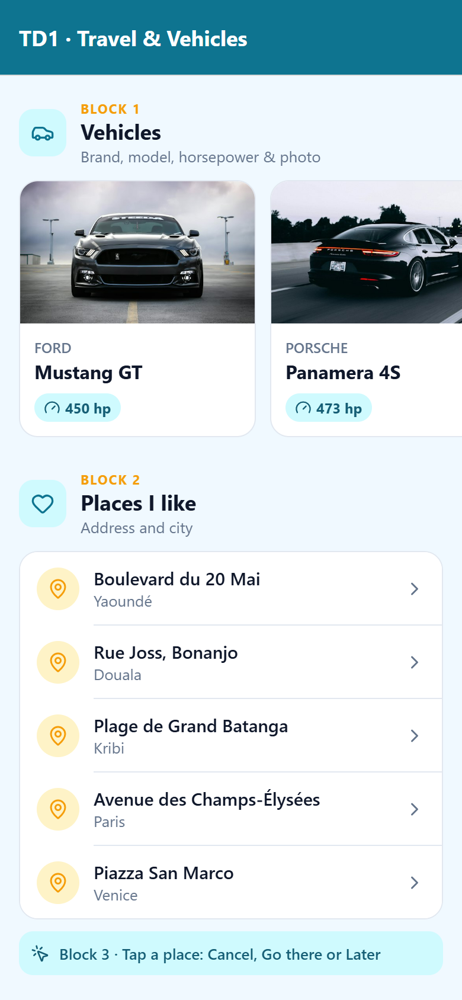](captures/chap2-td1-ui-layouts/screenshot-1-vehicles.png) | [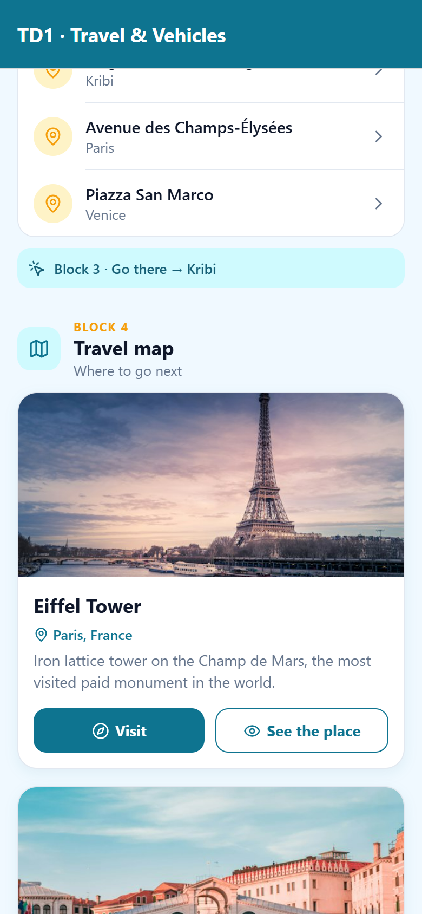](captures/chap2-td1-ui-layouts/screenshot-2-places-dialog.png) | [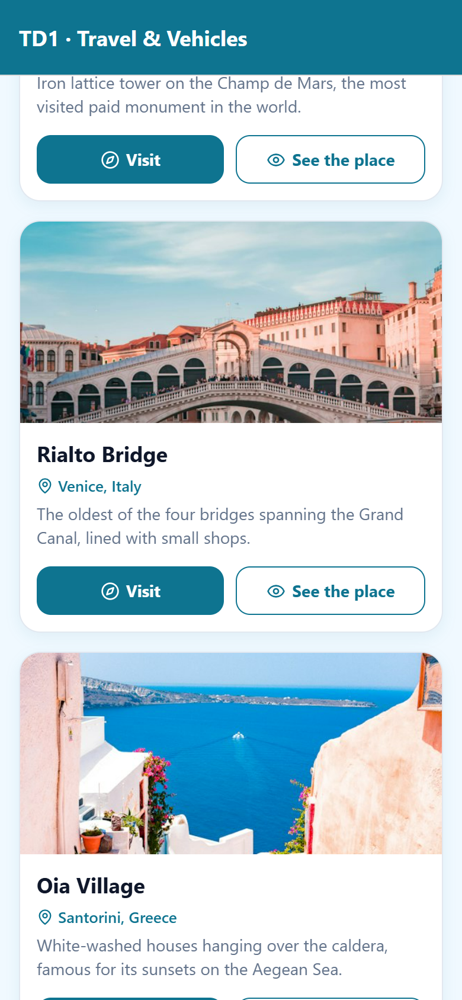](captures/chap2-td1-ui-layouts/screenshot-3-travel-map.png) |

## 2. TD2: Icons, colors, Action Sheet, Toolbar & Footer

Dynamic list of people → action sheet showing the chosen person's name with *Call, Info, Share, Delete, Cancel* (one icon each), a different color per place, custom Toolbar with an ellipsis button, Footer *Copyright 2025*.

| People list | Action sheet | Colored places + footer |
|---|---|---|
| [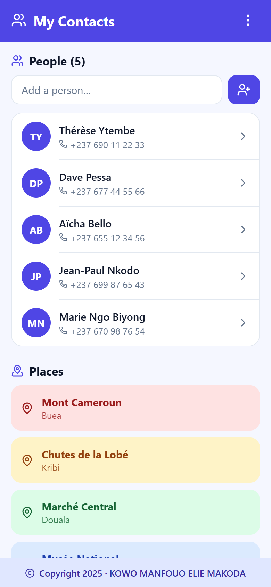](captures/chap2-td2-icons-actionsheet/screenshot-1-people.png) | [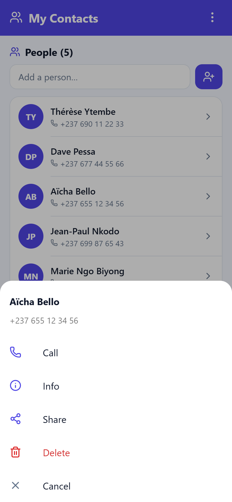](captures/chap2-td2-icons-actionsheet/screenshot-2-action-sheet.png) | [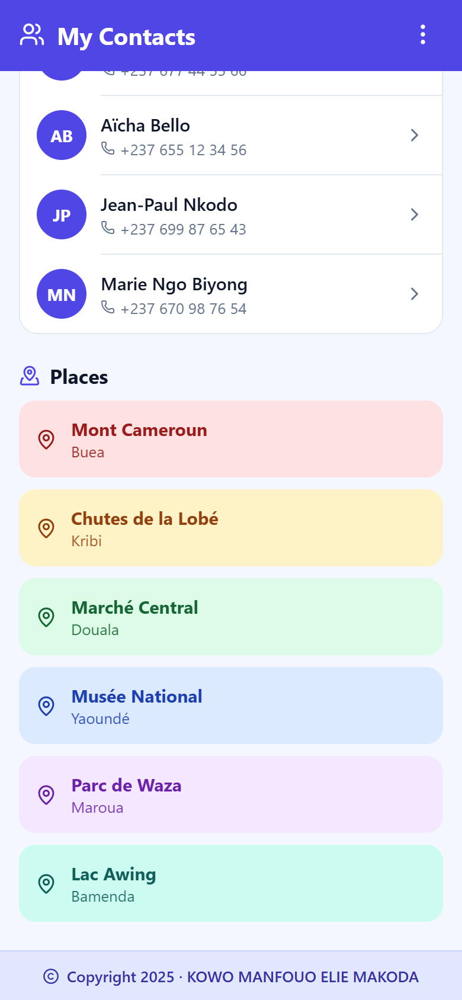](captures/chap2-td2-icons-actionsheet/screenshot-3-places-footer.png) |

## 3. Assignment: Left menu & tabbed navigation

Drawer menu *Home, Preferences, My Profile, About* (one folder each), Home uses Tabs *Home, People, Fruits*, menu button in the headers, different header colors for People and Fruits, detail views with route parameters.

| Home (tabs) | Left menu | People |
|---|---|---|
| [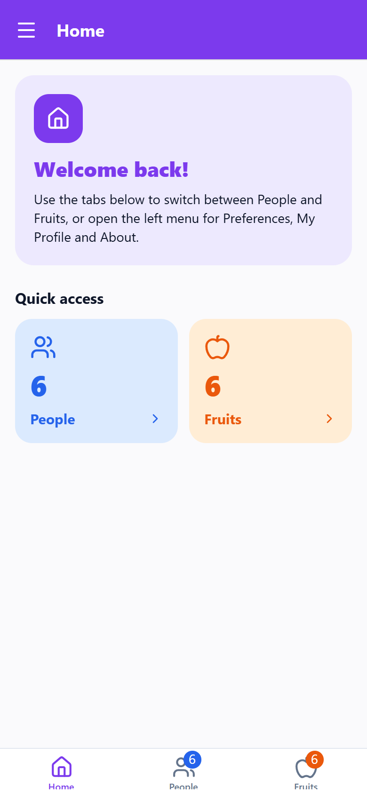](captures/chap2-assignment-drawer-tabs/screenshot-1-home-tabs.png) | [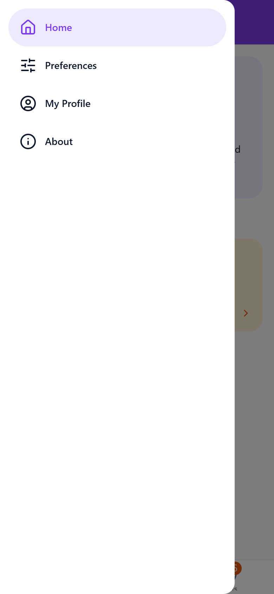](captures/chap2-assignment-drawer-tabs/screenshot-2-left-menu.png) | [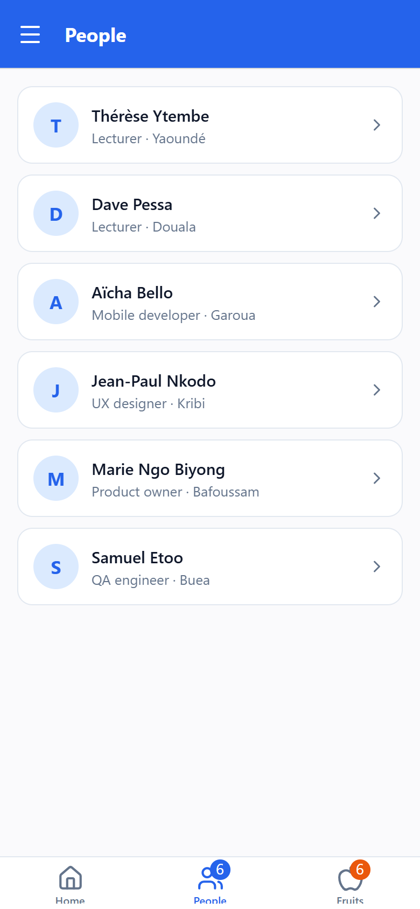](captures/chap2-assignment-drawer-tabs/screenshot-3-people.png) |

| Fruits | Fruit detail (route param) | Preferences |
|---|---|---|
| [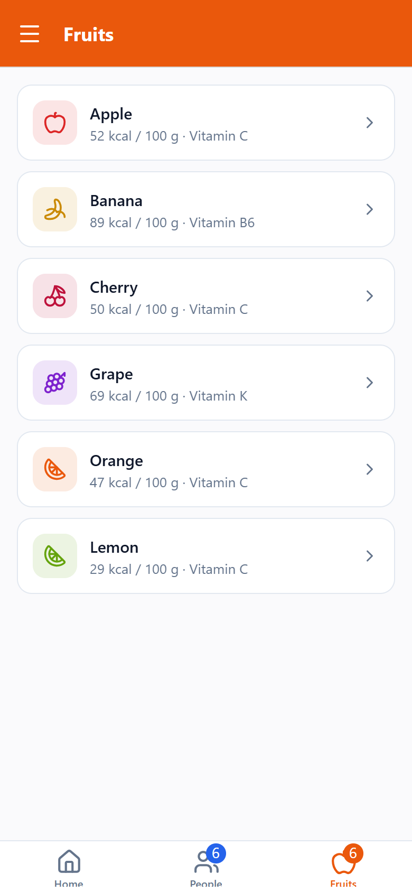](captures/chap2-assignment-drawer-tabs/screenshot-4-fruits.png) | [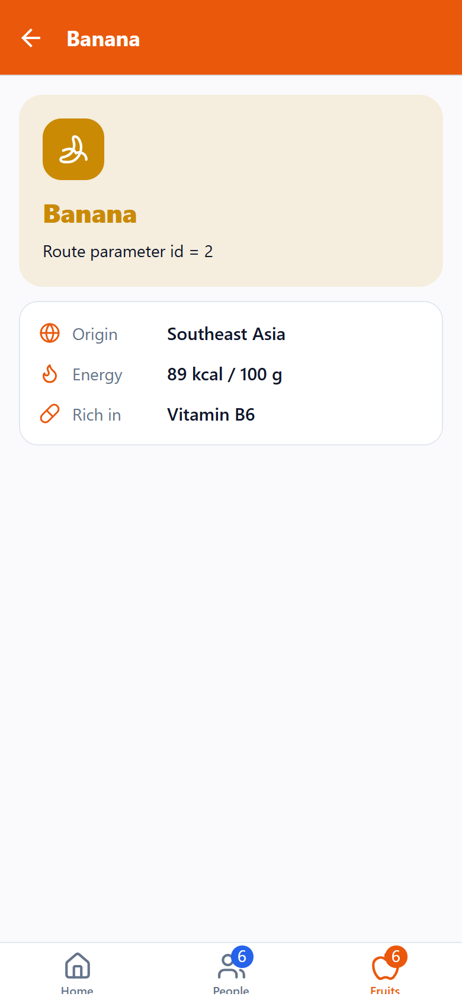](captures/chap2-assignment-drawer-tabs/screenshot-5-fruit-detail.png) | [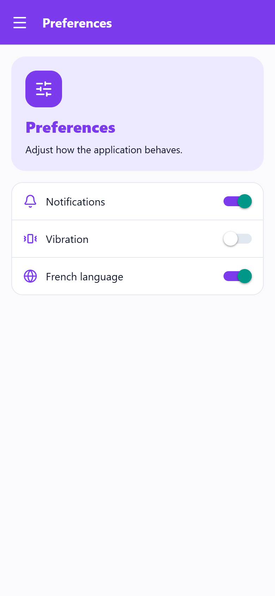](captures/chap2-assignment-drawer-tabs/screenshot-6-preferences.png) |

## 4. Local Storage: AsyncStorage

`utils/AsyncStorage.ts` with `setItem`, `getItem`, `removeItem`, `mergeItem`, `clear`, `getAllKeys`, `getAllItems` (multiGet), used by a username field, a merged user profile, preferences and a storage inspector.

| setItem / mergeItem | Storage inspector |
|---|---|
| [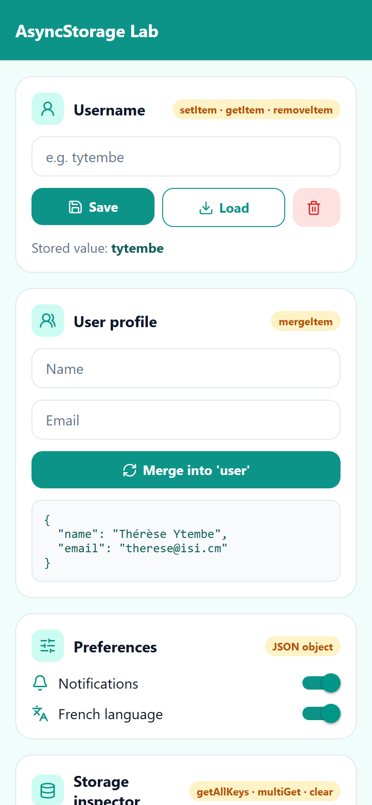](captures/localstorage-asyncstorage/screenshot-1-set-merge.png) | [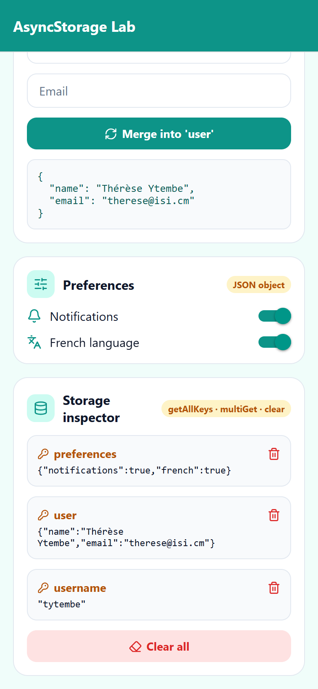](captures/localstorage-asyncstorage/screenshot-2-storage-inspector.png) |

## 5. Local Storage: Task Tracker (SQLite)

`database/db.ts` (create, fetch by status, insert, update, delete) with the `TaskCounter`, `TaskInput`, `StatusFilter` and `TaskItem` components, plus an About screen.

| All tasks | Ongoing filter | About |
|---|---|---|
| [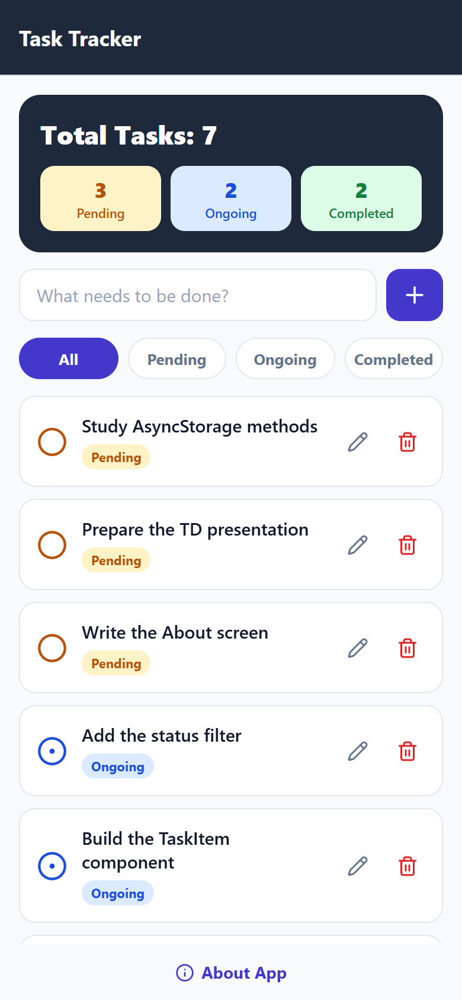](captures/localstorage-task-tracker/screenshot-1-all-tasks.png) | [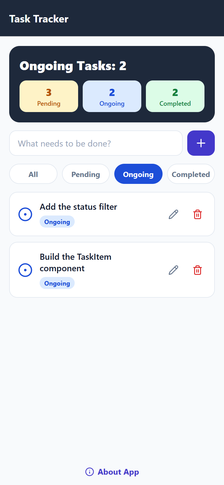](captures/localstorage-task-tracker/screenshot-2-filter-ongoing.png) | [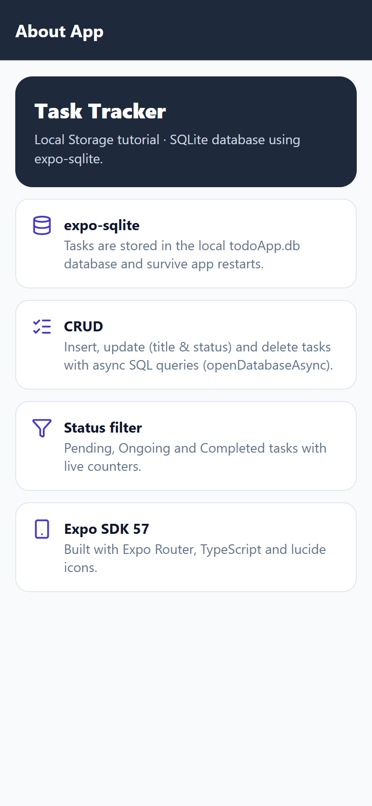](captures/localstorage-task-tracker/screenshot-3-about.png) |
